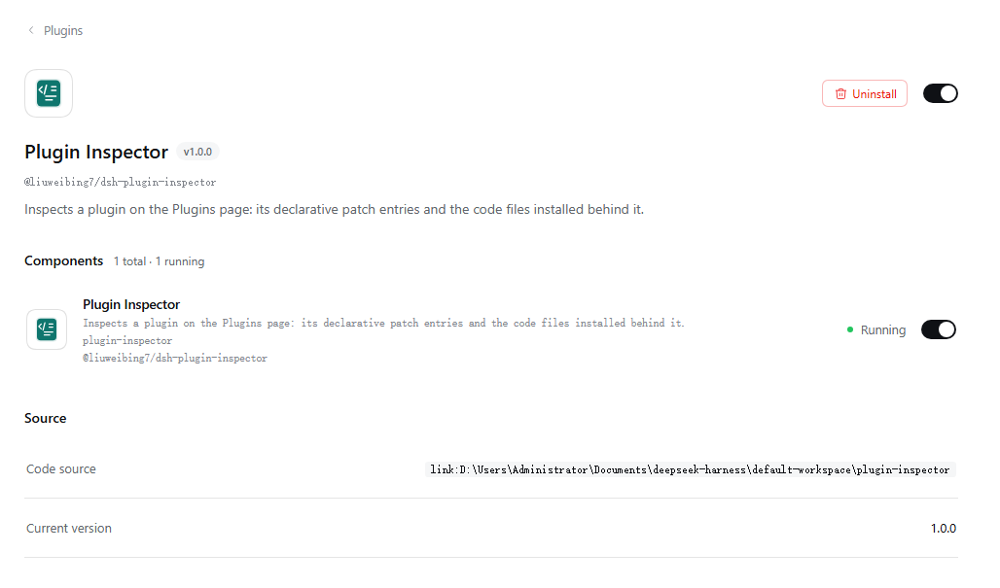
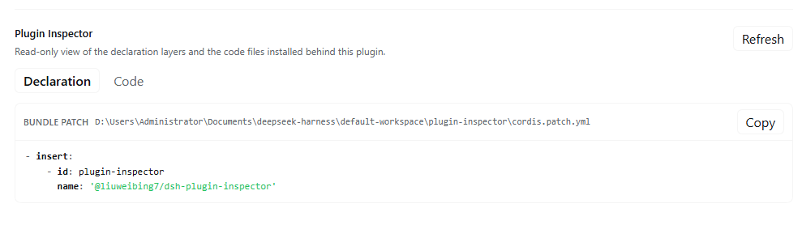
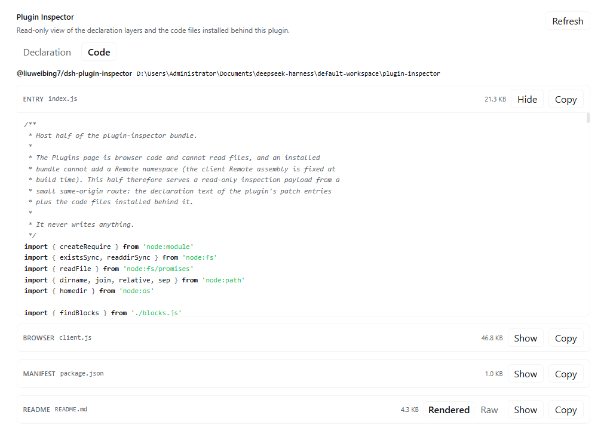

English | [中文](README.zh.md)

# dsh-plugin-inspector

A DeepSeek Harness (DSH) plugin that shows what a plugin is made of, on its own page in the **Plugins** screen:

- **Declaration** — the exact YAML patch entries that declare the plugin, read from the active profile's `cordis.patch.yml` and from its bundle's `cordis.patch.yml`. Each block shows the source path, the exact text, copy, and the whole file.
- **Code** — the files installed behind the plugin: `package.json`, the Host entry, the browser bundle, any shipped `src/` sources, the README, and the type entry. YAML, JSON, JS/TS, and Markdown are syntax highlighted; Markdown defaults to a rendered view with a rendered/raw toggle.

The Code tab is loaded only when you open it; the declaration is loaded when the page opens.

## Screenshots

The plugin's page in the Plugins screen, with the inspector section open:



The **Declaration** tab reads the exact YAML that declares the plugin — the profile override and the bundle patch — with the file path beside it:



The **Code** tab reads the files installed behind the plugin — Host entry, browser bundle, manifest, README — with syntax highlighting and a rendered/raw toggle for Markdown:



## Requirements

- DSH Web GUI (`http://`). The section is not available in a `file://` shell.
- The plugin page must exist for the subject: a bundle page, a row configuration page, or an official plugin page.

## Install

From the DSH plugin market once listed, or directly from GitHub:

```sh
dsh plugin --profile <profile> add github:liuweibing7/dsh-plugin-inspector
```

From a local checkout:

```sh
dsh plugin --profile <profile> add /path/to/dsh-plugin-inspector
```

Restart or refresh the Web UI after installing, depending on the host. The plugin adds one section (`plugins.detail.section`, id `plugin-inspector`) and one Host route (`/plugin-inspector`).

## How it works

- **Host half** (`index.js`, `blocks.js`) registers a same-origin `POST /plugin-inspector` route. It reads the active profile's patch files and the installed package files, then returns JSON. It never writes anything.
- **Browser half** (`client.js`) registers `plugins.detail.section` and renders the two tabs. It cannot read files directly, so all text comes from the Host route.
- The route refuses cross-origin requests and sets no CORS header. It is served by the Host's loopback Web server like the rest of the UI.
- Declaration and code payloads are cached per subject in the page, bounded to 10 subjects. The Code tab fetches only when first opened.

## Security notes

This is a local inspection tool. It reads:

- the active profile's `cordis.patch.yml` / `cordis.yml` / patch overlays;
- `package.json` and installed files of the plugin packages you open.

It does not write files, does not send anything to the network, and does not execute plugin code. The rendered Markdown is escaped HTML (raw HTML in a README is shown as text, and `javascript:` links are not turned into links). Links open in a new tab.

## Limits

- Most packages ship built `lib/*.js`; original TypeScript appears only when the package publishes `src/` (for example `@deepseek-ai/cordis`).
- A file is truncated to 256 KiB, a response to 1.6 MiB, and at most 16 files are returned; highlighting covers the first 120 KiB of a block.
- The Markdown renderer covers headings, paragraphs, lists, blockquotes, fenced/inline code, links, emphasis, rules, and simple tables. Nested lists are flattened; images become links; raw HTML is escaped.
- Not available in `file://` runtimes.

## Development

No build step. The package is plain ESM plus a hand-written browser bundle loaded by `window.__ModuleLoader__`.

```
package.json         dsh.bundle.patch + dsh.client + exports
cordis.patch.yml     inserts the plugin-inspector row
index.js             Host half: route + profile/patch/package reads
blocks.js            exact YAML list-item extraction
client.js            browser half: slots, tabs, highlighting, Markdown
locale/*.json        display metadata (title/description)
icon.svg             plugin icon
```

To try it from a checkout:

```sh
dsh plugin --profile <profile> add /absolute/path/to/this/repo
```

## License

MIT
