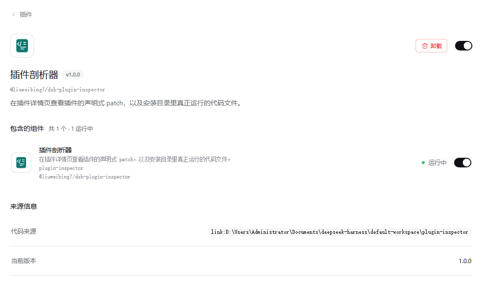
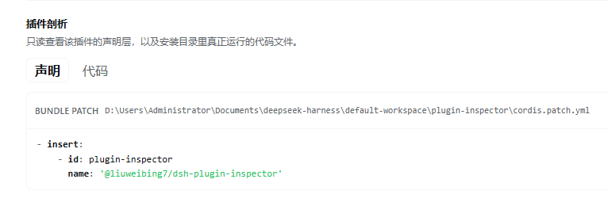
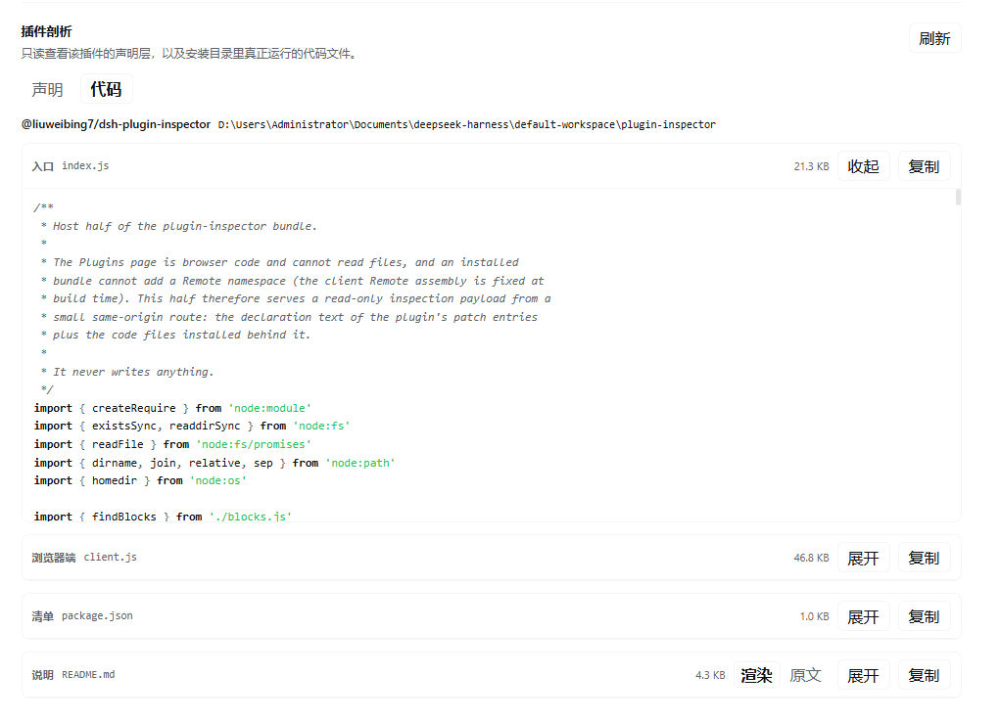

[English](README.md) | 中文

# dsh-plugin-inspector

一个 DeepSeek Harness（DSH）插件，在**插件**页面展示每个插件由什么组成：

- **声明** —— 声明该插件的 YAML patch 条目原文，来自当前 profile 的 `cordis.patch.yml` 与其 bundle 的 `cordis.patch.yml`。每一块都显示来源路径、原始文本、复制按钮，以及整个文件。
- **代码** —— 插件安装后背后的文件：`package.json`、Host 入口、浏览器 bundle、随包发布的 `src/` 源码、README、类型入口。YAML、JSON、JS/TS、Markdown 都有语法高亮；Markdown 默认显示渲染结果，并可切换回原文。

代码 Tab 只在第一次打开时读取；声明在页面打开时读取。

## 截图

插件在 Plugins 页面中的详情页，剖析区块已展开：



**声明** Tab 显示声明该插件的 YAML 原文——profile 覆盖与 bundle patch——旁边是文件路径：



**代码** Tab 显示插件安装后的文件——Host 入口、浏览器 bundle、清单、README——带语法高亮，Markdown 可切换渲染/原文：



## 环境要求

- DSH Web GUI（`http://`）。`file://` 运行方式下没有这个区块。
- 被查看的插件必须有对应的详情页：bundle 页、某个可配置行的页面，或官方插件页。

## 安装

收录后可从 DSH 插件市场安装，或直接从 GitHub 安装：

```sh
dsh plugin --profile <profile> add github:liuweibing7/dsh-plugin-inspector
```

从本地目录安装：

```sh
dsh plugin --profile <profile> add /path/to/dsh-plugin-inspector
```

安装后按宿主要求重启或刷新 Web UI。插件会注册一个区块（`plugins.detail.section`，id 为 `plugin-inspector`）和一个 Host 路由（`/plugin-inspector`）。

## 工作原理

- **Host 半**（`index.js`、`blocks.js`）注册同源的 `POST /plugin-inspector` 路由。它读取当前 profile 的 patch 文件和已安装包的文件，然后返回 JSON。它不写任何东西。
- **浏览器半**（`client.js`）注册 `plugins.detail.section`，渲染两个 Tab。浏览器不能直接读文件，所以所有文本都来自 Host 路由。
- 路由拒绝跨站请求，不设置 CORS 头。它由 Host 的回环 Web 服务器提供，和界面其余部分一样。
- 声明与代码的响应按 subject 缓存在页面中，最多 10 个 subject。代码 Tab 只在第一次打开时请求。

## 安全说明

这是一个本地检查工具。它会读取：

- 当前 profile 的 `cordis.patch.yml` / `cordis.yml` / patch overlay；
- 你打开的那个插件包的 `package.json` 和已安装文件。

它不写文件、不向网络发送任何内容、不执行插件代码。渲染的 Markdown 是转义后的 HTML（README 里的原始 HTML 会以文本显示，`javascript:` 链接不会变成可点击链接）。链接在新标签页打开。

## 限制

- 大多数包只发布构建后的 `lib/*.js`；只有随包发布 `src/` 的包（例如 `@deepseek-ai/cordis`）才能看到原始 TypeScript。
- 单个文件截断到 256 KiB，单次响应截断到 1.6 MiB，最多返回 16 个文件；高亮覆盖每个块的前 120 KiB。
- Markdown 渲染器支持标题、段落、列表、引用、围栏/行内代码、链接、强调、分隔线和简单表格。嵌套列表会被摊平；图片变成链接；原始 HTML 会被转义。
- `file://` 运行方式下不可用。

## 开发

没有构建步骤。这个包是普通 ESM，加上一个由 `window.__ModuleLoader__` 加载的手写浏览器 bundle。

```
package.json         dsh.bundle.patch + dsh.client + exports
cordis.patch.yml     插入 plugin-inspector 行
index.js             Host 半：路由 + profile/patch/package 读取
blocks.js            精确截取 YAML 列表项
client.js            浏览器半：slot、Tab、高亮、Markdown
locale/*.json        展示元数据（标题/描述）
icon.svg             插件图标
```

从本地 checkout 试用：

```sh
dsh plugin --profile <profile> add /absolute/path/to/this/repo
```

## License

MIT
